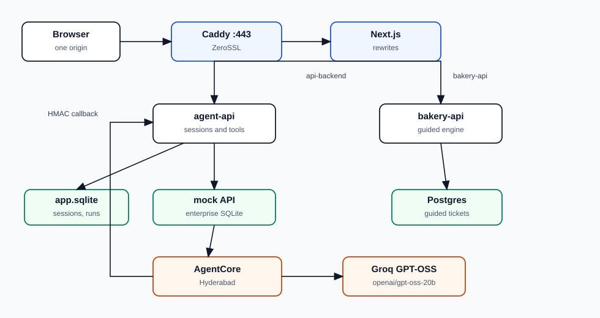
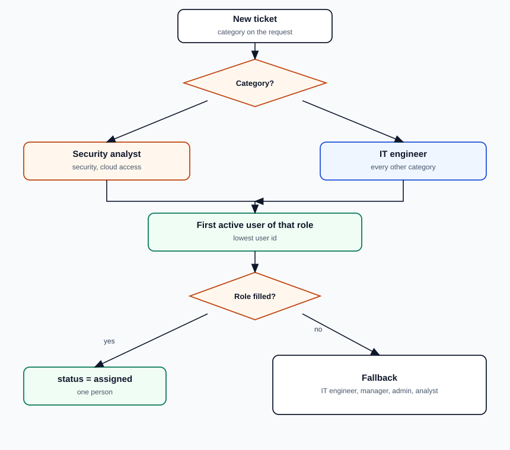
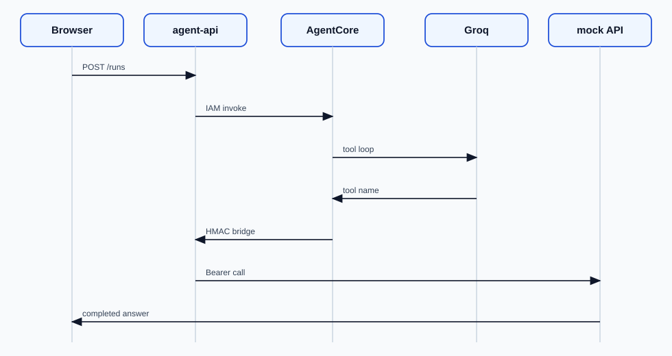

# CloudiQS Demo — Enterprise IT Helpdesk

**Version 1**

Local Docker demo of an enterprise IT helpdesk with guided support, tickets, devices, approvals, and policy-aware remediations. Enterprise connectors are synthetic; application APIs, policies, approvals, persistence, and UI are real demo code.

Initial demo data is in `data/initial/`.

## Quick start

```bash
cp .env.example .env
docker compose up --build -d
```

Open **http://localhost:3000** and sign in with a Northstar persona (for example Asha Rao).

| Service | URL | Notes |
|---|---|---|
| Web UI | http://localhost:3000 | Bound to localhost |
| Agent API | http://localhost:8001 | Session cookies; OpenAPI `/docs` |
| Enterprise mock API | http://localhost:8000 | Diagnostics / fixtures |

Default `MODEL_PROVIDER=simulator` runs deterministic scenario paths against the mock tools. Set `MODEL_PROVIDER=bedrock` with AWS credentials for Bedrock-backed orchestration.

## Personas

Northstar employees and IT staff are available from the login screen (`northstar-asha`, `northstar-rahul`, `northstar-priya`, `northstar-vikram`, `northstar-arjun-security`, and related employee personas).

## Useful commands

```bash
docker compose ps
docker compose logs -f agent-api
docker compose exec enterprise-mock-api pytest -q
docker compose exec agent-api pytest -q
# Reset mutable demo state (destructive):
make reset-demo CONFIRM=YES
```

## Architecture

The handbook is `docs/APPLICATION.md`. Diagrams are image files in `docs/diagrams/` (open the Markdown preview to see them in the doc).







Browser → Next.js → FastAPI control plane → simulator, Groq, or AgentCore → typed tools → enterprise mock API → SQLite. Guided help uses the bakery API and Postgres.

See also `docs/ARCHITECTURE.md`, `docs/SECURITY_MODEL.md`, `docs/DEMO_WALKTHROUGH.md`, and `docs/TEST_RESULTS.md`.

## Known limitations

- Simulator mode is labelled and is not model inference.
- Bedrock requires account model access; without credentials the stack stays on simulator mode.
- No Cognito/OIDC, no production AgentCore Runtime, and no real MFA reset / remote wipe.
- All identities and remediations are fictional simulations.
