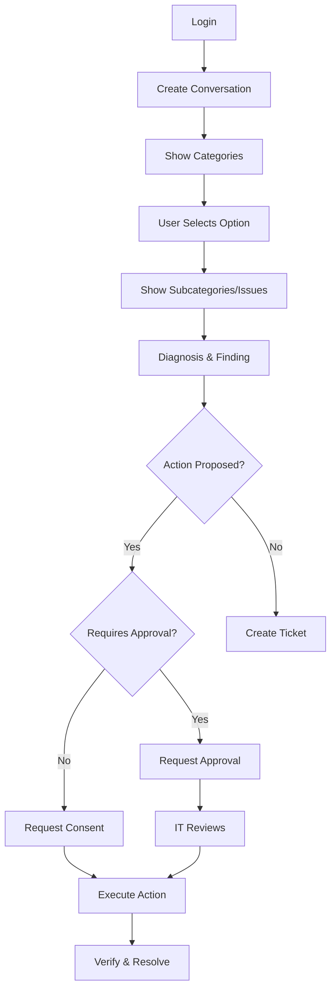

# 🥐 Agentic Bakery Pro - Quick Start Guide

Complete Next.js 14 web UI for the guided IT helpdesk system.

## 📁 File Tree

```
apps/bakery_web/
├── app/
│   ├── page.tsx                 # Login page (demo persona selection)
│   ├── layout.tsx               # Root layout with metadata
│   ├── globals.css              # Tailwind + custom styles
│   ├── helpdesk/
│   │   └── page.tsx            # Main helpdesk interface (employee view)
│   └── it/
│       └── page.tsx            # IT engineer approval queue
│
├── components/
│   ├── DemoModeBanner.tsx      # Persistent "DEMO MODE" banner
│   └── SidePanel.tsx           # User info, devices, navigation
│
├── lib/
│   ├── api-client.ts           # API wrapper with credentials: 'include'
│   └── types.ts                # TypeScript interfaces
│
├── middleware.ts               # Route protection
├── package.json                # Dependencies & scripts
├── next.config.js              # API rewrites for /api/* proxy
├── tsconfig.json               # TypeScript configuration
├── tailwind.config.ts          # Tailwind theme
├── postcss.config.js           # PostCSS for Tailwind
├── Dockerfile                  # Production Docker image
├── .dockerignore               # Docker build excludes
├── .gitignore                  # Git excludes
├── .env.example                # Environment variable template
├── start.sh                    # Quick start script (Linux/Mac)
├── start.bat                   # Quick start script (Windows)
└── README.md                   # Detailed documentation
```

## 🚀 Quick Start

### Prerequisites

- **Node.js 20+** installed
- **Backend API** running at `http://localhost:8002`

### Option 1: Automated Start (Recommended)

**Windows:**
```bash
.\start.bat
```

**Linux/Mac:**
```bash
chmod +x start.sh
./start.sh
```

### Option 2: Manual Start

```bash
# Install dependencies
npm install

# Start development server
npm run dev
```

Open [http://localhost:3000](http://localhost:3000)

## 🎭 Demo Personas

Select one of these personas at login:

| User ID | Name | Role | Tenant | Use Case |
|---------|------|------|--------|----------|
| **NS-001** | Asha Rao | Employee | Northstar | General helpdesk, account locked, disk cleanup |
| **NS-002** | Rahul Sharma | IT Engineer | Northstar | Approve VPN cert renewal, review actions |
| **NS-003** | Priya Menon | IT Manager | Northstar | View analytics, manage team |
| **NS-004** | Vikram Rao | Tenant Admin | Northstar | Manage tenant settings |
| **BC-001** | Neha Kapoor | Employee | Beacon | Test tenant isolation, VPN issues |
| **BC-002** | David Thomas | IT Engineer | Beacon | Beacon-specific approvals |

## 🎯 Key Features

### 1. **Login Page** (`/`)
- Demo persona selection cards
- Cookie-based authentication
- Persistent demo mode banner
- Auto-redirects to helpdesk after login

### 2. **Employee Helpdesk** (`/helpdesk`)
- **Welcome Screen**: Dynamic categories from `GET /api/catalog`
- **Navigation**: Breadcrumb showing category → subcategory → issue path
- **Option Selection**: Clickable chips/cards from `response.options`
- **Free Text Input**: Always available for custom descriptions
- **Controls**: Back, Start Over, Something Else, Talk to IT
- **Finding Card**: Diagnosis with evidence from backend tools
- **Action Proposal**: Shows consent/approval workflow
- **Ticket Card**: Real ticket IDs with status
- **Side Panel**: 
  - User info (name, role, tenant)
  - Assigned devices with health metrics
  - Navigation to My Tickets
  - Logout button

### 3. **My Tickets View**
- List of user's tickets from `GET /api/tickets/mine`
- Real-time status (open, resolved, pending, etc.)
- Priority, team assignment, creation date
- Integrated into helpdesk page (toggle view)

### 4. **IT Engineer Queue** (`/it`)
- Pending approvals from `GET /api/approvals/pending`
- Shows:
  - Requester name and details
  - Action description and impact
  - Target resource
  - Expiration time
- **Review & Decide**: Approve or Reject with optional reason
- **Real-time execution**: Approved actions execute immediately
- Role-based access (IT Engineer, IT Manager, Tenant Admin only)

## 🔄 Conversation Flow



## 🔧 API Integration

All requests use `credentials: 'include'` for cookie-based auth.

### API Rewrites (next.config.js)

```javascript
// In Docker: /api/* → http://bakery-api:8000/*
// Locally:  /api/* → http://localhost:8002/*
```

### Key Endpoints Used

| Endpoint | Method | Purpose |
|----------|--------|---------|
| `/api/auth/demo-login` | POST | Login with persona ID |
| `/api/me` | GET | Current user info & devices |
| `/api/catalog` | GET | Dynamic categories (never hardcoded) |
| `/api/conversations` | POST | Start new conversation |
| `/api/conversations/{id}/turns` | POST | Send option/text/control |
| `/api/tickets/mine` | GET | User's tickets |
| `/api/approvals/pending` | GET | Pending approvals (IT only) |
| `/api/approvals/{id}/decision` | POST | Approve/reject |
| `/api/actions/{id}/consent` | POST | Consent to action |
| `/api/actions/{id}/execute` | POST | Execute approved action |

## 🐳 Docker Deployment

### Build Image

```bash
docker build -t bakery-web .
```

### Run Container

```bash
docker run -p 3000:3000 \
  -e BAKERY_API_URL=http://bakery-api:8000 \
  bakery-web
```

### Docker Compose Example

```yaml
version: '3.8'

services:
  bakery-web:
    build: ./apps/bakery_web
    ports:
      - "3000:3000"
    environment:
      - BAKERY_API_URL=http://bakery-api:8000
      - NODE_ENV=production
    depends_on:
      - bakery-api
    restart: unless-stopped

  bakery-api:
    # Your backend service config
    ports:
      - "8002:8000"
```

## 🎨 UI Design Principles

1. **Restrained Enterprise SaaS**: Professional, not flashy
2. **Never Hardcode Issues**: Always fetch from `/api/catalog`
3. **Dynamic Options**: Render `response.options` from backend
4. **Real IDs**: Display actual ticket/conversation/action IDs
5. **Demo Transparency**: Persistent banner shows "simulated systems"
6. **No Fake Metrics**: Only show data from API responses
7. **Responsive**: Works on desktop and mobile

## 📝 Environment Variables

Create `.env.local` for customization:

```bash
# Backend API URL (optional, defaults to rewrites)
NEXT_PUBLIC_BAKERY_API_URL=http://localhost:8002

# For Docker (used in next.config.js)
BAKERY_API_URL=http://bakery-api:8000
```

## 🧪 Testing Scenarios

### Employee Workflows (NS-001 Asha)

1. **Account Locked** → Unlock flow
   - Login as NS-001
   - Select: Account, password & access → Password and login → Account locked
   - Should see diagnosis and unlock option

2. **Low Disk Space** → Cleanup
   - Select: Laptop performance & updates → Performance → Low disk space
   - View safe temp files to clean
   - Consent to cleanup
   - Verify disk space increase

3. **Free Text Input**
   - Type: "VPN won't connect"
   - Should classify and route to VPN issue

4. **Create Ticket**
   - Click "I can't find my issue"
   - Describe problem
   - Submit ticket
   - Verify ticket ID shown

### IT Engineer Workflows (NS-002 Rahul)

1. **Approve VPN Certificate Renewal**
   - Login as NS-002
   - Navigate to `/it` (or click IT Queue if available)
   - Review pending approval for Asha's VPN cert
   - Approve with reason
   - Action executes automatically

2. **Reject Action**
   - Review approval request
   - Reject with reason
   - User is notified

### Tenant Isolation (BC-001 Neha)

1. **Different Tenant Data**
   - Login as BC-001 (Beacon tenant)
   - Should only see Beacon devices and tickets
   - Cannot access Northstar data

## 🔍 Troubleshooting

### Backend Not Running

**Symptom**: Login fails with connection error

**Solution**: 
```bash
# Check if backend is running
curl http://localhost:8002/health

# Start backend first
cd apps/bakery_api
python -m uvicorn main:app --reload --port 8002
```

### CORS Errors

**Symptom**: Network errors in browser console

**Solution**: Backend must allow credentials:
```python
# In FastAPI backend
app.add_middleware(
    CORSMiddleware,
    allow_origins=["http://localhost:3000"],
    allow_credentials=True,  # ← Required
    allow_methods=["*"],
    allow_headers=["*"],
)
```

### 401 Unauthorized After Login

**Symptom**: Redirects to login immediately

**Solution**: 
- Check cookie is being set by backend
- Verify `credentials: 'include'` in API calls
- Check cookie domain/path settings

### Options Not Showing

**Symptom**: Empty options list

**Solution**:
- Verify backend `/api/catalog` returns valid data
- Check conversation state in network tab
- Ensure backend is seeded with `guided_flow_catalog.json`

### Build Errors

**Symptom**: TypeScript or dependency errors

**Solution**:
```bash
# Clear cache and reinstall
rm -rf node_modules .next
npm install

# Check Node version
node --version  # Should be 20+
```

## 📦 Production Checklist

- [ ] Backend API accessible from container
- [ ] `BAKERY_API_URL` environment variable set
- [ ] CORS configured for production domain
- [ ] Cookie `secure` flag set for HTTPS
- [ ] Session timeout configured
- [ ] Rate limiting enabled on backend
- [ ] Error monitoring configured
- [ ] Health check endpoint working
- [ ] Static assets optimized

## 🤝 Integration with Backend

This frontend expects the backend to implement:

1. **Catalog API**: Returns dynamic categories (never hardcoded)
2. **Conversation State**: Tracks user navigation and context
3. **Action Intent**: Creates immutable action proposals
4. **Approval Workflow**: Role-based review for privileged actions
5. **Verification**: Backend verifies action results before resolving
6. **Tenant Isolation**: Enforces data boundaries server-side

## 📚 Related Documentation

- [Spec](../../specs/agentic_bakery_helpdesk/CURSOR_MASTER_SPEC.md): Full system requirements
- [Backend API](../bakery_api/README.md): FastAPI implementation
- [Catalog](../../specs/agentic_bakery_helpdesk/guided_flow_catalog.json): Issue taxonomy

## 🎓 Learning the Codebase

1. Start with `app/page.tsx` (login)
2. Follow to `app/helpdesk/page.tsx` (main UI)
3. Examine `lib/api-client.ts` (API wrapper)
4. Review `lib/types.ts` (data structures)
5. Check `components/SidePanel.tsx` (navigation)
6. Study `app/it/page.tsx` (IT workflows)

## 🚦 Status Indicators

| Status | Meaning | UI Treatment |
|--------|---------|--------------|
| `resolved` | Action completed & verified | Green check, "Resolved in demo" |
| `pending_approval` | Awaiting IT review | Amber clock, "Pending approval" |
| `awaiting_user` | Waiting user confirmation | Blue info, "Confirm this worked" |
| `ticket_open` | Escalated to ticket | Purple ticket, Show ticket ID |
| `escalated` | Requires specialist | Red alert, "Escalated to team" |
| `refused` | Action not allowed | Red X, "Cannot proceed" |
| `waiting_external` | External dependency | Gray clock, "Waiting for service" |

## 📄 License

Internal CloudiQS Project - Not for public distribution

---

**Ready to start?** Run `.\start.bat` (Windows) or `./start.sh` (Linux/Mac)
